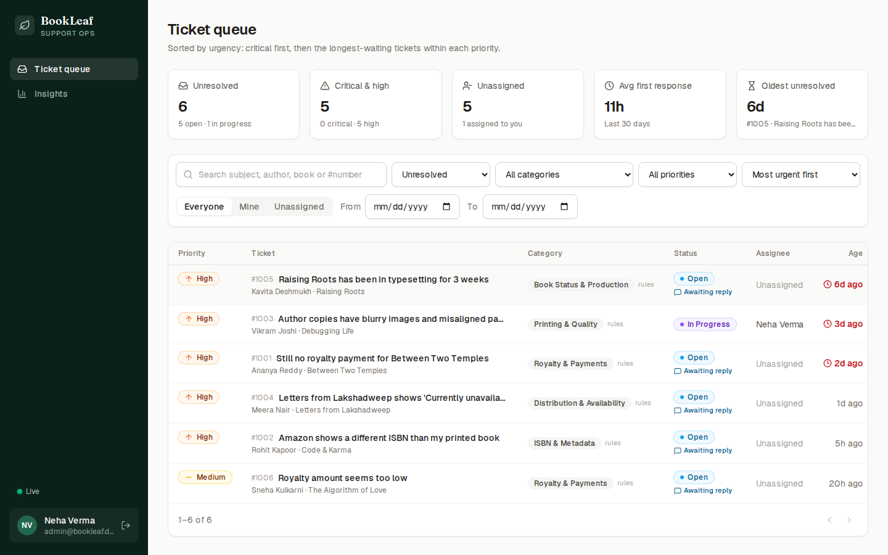
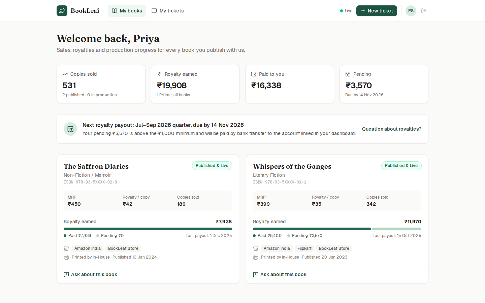
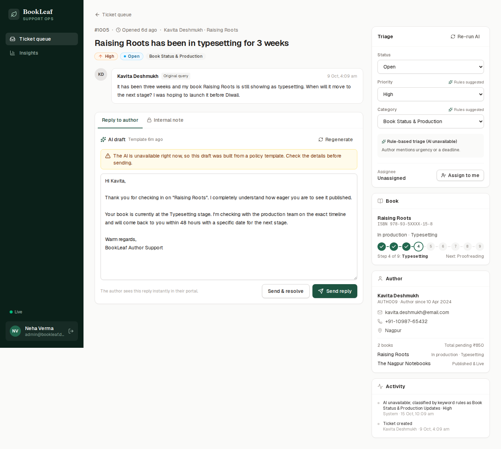
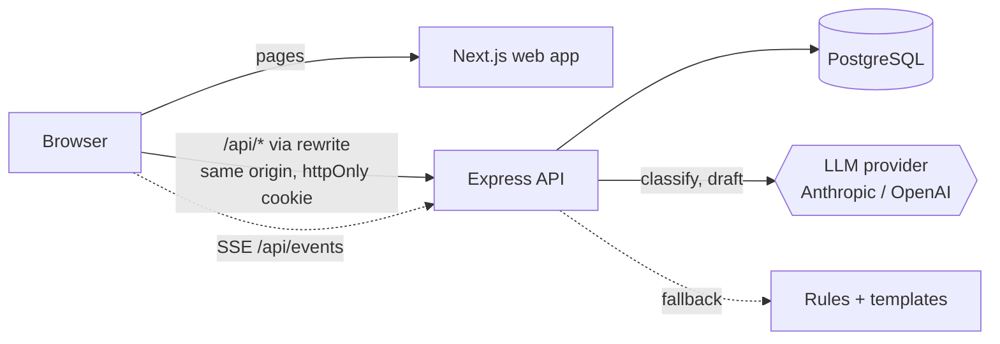

# BookLeaf Author Support Portal

An author support and communication portal for BookLeaf Publishing. Authors track their books and royalties and raise support tickets. The operations team works a prioritised queue where AI classifies every ticket and drafts a policy-accurate reply for a person to review and send.

**Stack:** Next.js 16 + React 19 + Tailwind CSS 4 (web) · Express 5 + TypeScript (API) · PostgreSQL + Prisma 7 · Anthropic or OpenAI (provider-agnostic) · Server-Sent Events · Vitest



| Author: My Books                               | Admin: AI-assisted ticket workspace                |
| ---------------------------------------------- | -------------------------------------------------- |
|  |  |

> The screenshots were taken with no LLM key configured, so they show the fallback mode: keyword-rule triage and policy template drafts. With a key set, the same screens show model output.

---

## Contents

- [Demo accounts](#demo-accounts)
- [Run it locally](#run-it-locally)
- [Features](#features)
- [Architecture](#architecture)
- [AI integration](#ai-integration)
- [API](#api)
- [Testing](#testing)
- [Deployment](#deployment)
- [Scaling notes](#scaling-notes)
- [Known limitations and next steps](#known-limitations-and-next-steps)

---

## Demo accounts

All 10 authors and 18 books from `bookleaf_sample_data.json` are seeded as-is. The login page also has one-click demo buttons.

| Role   | Email                                 | Password    | Good for                                                        |
| ------ | ------------------------------------- | ----------- | --------------------------------------------------------------- |
| Author | `priya.sharma@email.com`              | `author123` | Two live books, pending royalty                                 |
| Author | `kavita.deshmukh@email.com`           | `author123` | A book in production; balance below the ₹1,000 payout threshold |
| Author | `sneha.kulkarni@email.com`            | `author123` | Three books, including one at Cover Design                      |
| Author | any other author email in the dataset | `author123` |                                                                 |
| Admin  | `admin@bookleaf.demo`                 | `admin123`  | Neha Verma, support team                                        |
| Admin  | `ops@bookleaf.demo`                   | `admin123`  | Rahul Mehta, a second admin, for assignment                     |

The seed also creates eight demo tickets covering every category, left **unclassified**. The API's startup sweep classifies them through the real pipeline (the LLM if a key is set, keyword rules otherwise), so nothing in the seed pretends to be model output.

**Try the real-time flow:** open an author and an admin in two browsers (or a normal and a private window). Raise a ticket as the author: it appears in the admin queue instantly and gets classified a moment later. Reply as the admin: the reply shows up on the author's ticket without a refresh.

---

## Run it locally

**Prerequisites:** Node.js 20+ and Docker (for Postgres).

```bash
npm install
cp apps/api/.env.example apps/api/.env      # then set JWT_SECRET, and an AI key if you have one
cp apps/web/.env.example apps/web/.env.local

npm run db:up        # Postgres in Docker
npm run db:migrate   # apply migrations
npm run db:seed      # load the sample dataset + demo tickets

npm run dev          # API on :4000, web on :3000
```

- App: http://localhost:3000
- API docs (Swagger UI): http://localhost:4000/api/docs

**Enable AI** by setting these in `apps/api/.env`:

```bash
AI_PROVIDER=anthropic          # or "openai", or "none"
ANTHROPIC_API_KEY=sk-ant-...   # or OPENAI_API_KEY
# optional per-task model overrides
AI_CLASSIFY_MODEL=claude-haiku-5-5
AI_DRAFT_MODEL=claude-haiku-5-5
```

Without a key everything still works, using rules and templates.

**Or run the whole stack in Docker:**

```bash
docker compose --profile app up --build    # http://localhost:3000
```

Useful scripts: `npm test`, `npm run typecheck`, `npm run lint`, `npm run format`, `npm run db:reset`.

---

## Features

### Author portal

- **Email/password login.** Each author only ever sees their own data, which the API enforces.
- **My Books.** Lifetime copies sold, royalty earned, paid and pending, plus a per-book breakdown: MRP, royalty per copy, a paid-versus-pending bar, last payout, platforms and print partner.
- **Payout insight.** The quarterly policy becomes a concrete date ("Jul–Sep 2026 quarter, due by 14 Nov 2026"). The page also explains whether the balance clears the ₹1,000 threshold or rolls over.
- **Books in production.** A step tracker shows the production pipeline (step 4 of 9: Typesetting, next: Proofreading) instead of empty sales figures.
- **Raise a ticket.** Book picker (or General / Account level), subject, description with counters, inline validation that mirrors the API, and attachment UI. A "Quick answers" panel deflects common questions.
- **My Tickets.** Status tabs, a "BookLeaf replied" indicator, and a conversation view. Admin replies arrive live, replying to a resolved ticket reopens it, and closed tickets are read-only.

### Admin portal

- **Ticket queue.**
  - Health tiles: unresolved, critical and high, unassigned, average first response, oldest waiting.
  - Filters: status, category, priority, assignee (everyone / mine / unassigned), date range and search. They're kept in the URL, so views can be shared.
  - Default **urgency sort**: Critical first, then oldest within each priority. Tickets waiting more than 48 hours are flagged.
  - An "Awaiting reply" marker, and a label showing whether a category came from the AI, from rules, or was edited by an admin.
- **Ticket workspace.**
  - The conversation, with internal notes styled so they can't be confused with replies.
  - An **AI draft composer**: the draft loads automatically when the author is waiting on us. Admins can regenerate or edit it, then choose "Send" or "Send & resolve".
  - A triage panel to override category and priority while keeping the AI's suggestion and reasoning visible, change status, and assign to themselves.
  - Book, author and audit-trail context, so agents never leave the ticket.
- **Insights.** AI calls, tokens, estimated cost, failure rate, and how often admins kept the AI's category and priority (a live accuracy signal), plus queue breakdowns.

---

## Architecture



```
apps/
  api/                     Express + TypeScript REST API
    prisma/                schema, migrations, seed + sample data
    src/
      ai/                  provider adapters, prompts, knowledge base, fallbacks
      services/            business logic (tickets, books, auth, AI, stats)
      routes/              thin HTTP layer: validate -> call service -> respond
      middleware/          auth, rate limits, error handler
      realtime/            SSE pub/sub
      validation.ts        Zod request schemas
    openapi.yaml           API spec, served at /api/docs
    tests/                 unit + integration tests
  web/                     Next.js App Router frontend
    src/app/               login, author/*, admin/* pages
    src/components/        UI kit, conversation, admin panels
    src/lib/               API client, types, labels, formatting
    src/proxy.ts           role-based routing guard
```

### Decisions and why

- **A separate Express API, not Next.js route handlers.** The brief asks for a clean REST layer. A standalone API makes that contract explicit, testable with supertest, documented with OpenAPI, and independently scalable. It also supports long-lived SSE connections, which serverless route handlers handle poorly.
- **The browser talks to one origin.** Next.js rewrites `/api/*` to the API, so the session cookie is first-party (`httpOnly`, `SameSite=Lax`) and the browser needs no CORS. API clients such as Postman use the same JWT as a Bearer token.
- **All data goes through the REST API.** Pages are client components using SWR rather than reading the database from server components, so access control lives in exactly one place.
- **Stateless JWT sessions.** The token carries id, role and authorId, so authorising a request needs no session store or extra query. That's what lets the API scale horizontally. The trade-off is that role changes apply when the token expires (8 hours).
- **Role-based access in the service layer.** Every query is scoped by `ownership(user)`. Another author's ticket returns **404, not 403**, so ticket ids can't be probed. Authors never receive internal notes, priority, AI fields or the audit trail.
- **Schema design** (`apps/api/prisma/schema.prisma`):
  - Book status is an enum mirroring the production pipeline.
  - Tickets store the AI's suggestion (`aiCategory`, `aiPriority`, `aiReason`) separately from the final values, so overrides are visible and accuracy is measurable.
  - Internal notes are messages with `isInternal`.
  - `TicketEvent` is an audit trail; `AiCall` logs every LLM request.
  - Indexes match the queue's filters and sorts. Ticket numbers start at #1001.
- **Real-time over Server-Sent Events.** Updates only flow server-to-client, so SSE is simpler than WebSockets and reconnects on its own. Events carry only a ticket id; clients refetch over REST, so no data bypasses access checks. A slow 30-second poll is the safety net.
- **Errors are consistent:** `{ error: { code, message, details? } }`. Zod failures become 400 with field-level details, followed by 401, 403, 404, 409, 413 and 429 as appropriate. A generic 500 is reserved for genuinely unexpected errors.

---

## AI integration

### What runs when

1. **Ticket created.** It's saved and returned to the author immediately. Classification runs after the response, so authors never wait on the LLM and an outage can't block ticket creation. The API pushes the result to admin screens over SSE. A sweep re-tries tickets left pending (for example, after a restart).
2. **Admin opens a ticket waiting on us.** A draft is requested, generated once, stored on the ticket and reused. It's regenerated only when the admin asks, or after the author writes again.
3. **Admin overrides.** The AI's suggestion is kept. Re-running triage never overwrites a value an admin changed.

### Prompt design (`apps/api/src/ai/prompts.ts`)

- **Classification.**
  - A rubric with category definitions and tie-break rules ("how do I update X" is General; "X is wrong" goes to the problem category).
  - Explicit priority levels with BookLeaf-specific examples, plus escalation rules for deadlines and repeated follow-ups.
  - The book's facts (sales, payout history) are passed in, so "never received royalty" on a selling book scores higher.
  - Output is a strict JSON schema (category, priority, and a one-line reason for the queue), then validated again with Zod.
- **Drafts.**
  - The system prompt encodes BookLeaf's tone guidelines as rules: acknowledge first, be specific, own BookLeaf's mistakes, give timelines, never blame the author, end with a next step.
  - Hard rules: use only provided facts, no invented numbers or names, a fixed sign-off, plain-text email, 90–200 words.
  - The user prompt carries only the policy section and playbook examples for the ticket's category.
  - It also carries **computed account facts**: the next payout date, whether the balance clears the threshold, the book's sales and royalty figures, and production stage and next step. That's what lets drafts quote real numbers and dates instead of vague reassurance.
  - The conversation window and the latest internal notes are included. Notes are used for accuracy and never quoted.
- **Prompt-injection guard.** Author text is labelled as data, and instructions inside it are ignored.

### Model choice

Defaults are **Anthropic `claude-haiku-5-5`** for both tasks ($0.10 / $0.50 per million input/output tokens), or `gpt-4o-mini` on OpenAI:

- Classification is a short structured task where a fast, cheap model is the right tool.
- Drafts are always reviewed by a person before sending, so the economics favour a cheap model with a strong prompt.
- If draft quality needs a step up, set `AI_DRAFT_MODEL` (for example, to `claude-sonnet-5-5`) without touching code.

The `LlmProvider` interface (`src/ai/llm.ts`) keeps the rest of the app provider-neutral. The Anthropic and OpenAI adapters are about 50 lines each, using the official SDKs with structured outputs.

### Graceful degradation

| Failure                                           | What happens                                                                                                             |
| ------------------------------------------------- | ------------------------------------------------------------------------------------------------------------------------ |
| No key / `AI_PROVIDER=none`                       | Keyword rules classify; drafts come from policy templates that still quote the author's real figures and dates           |
| Timeout, 429 or 5xx                               | The SDK retries with backoff (20s timeout, 2 retries), then falls back as above                                          |
| Model returns invalid JSON or an unknown category | Zod rejects it; rules take over and the issue is logged                                                                  |
| Refusal, empty or truncated output                | Treated as a failure; template draft                                                                                     |
| Any failure                                       | Recorded in `AiCall` with the error and shown in Insights; the UI labels rule/template output so admins know to check it |

### Cost management

- **Generate only what's used.** Classification runs once per ticket. Drafts are generated lazily for tickets an admin actually opens, cached on the ticket, and concurrent requests are de-duplicated.
- **Send only what's needed.** One category's policy section and examples (not the whole knowledge base), only the relevant book's facts, the last 8 messages, and long text truncated.
- **Prompt caching.** System prompts are static (no dates or ids), so Anthropic's prompt caching (`cache_control`) and OpenAI's automatic prefix caching bill repeat instructions at about a tenth of the price.
- **Bounded output.** `max_tokens` caps, low/medium effort, and a 25-word reason for classification.
- **Guard rails.** AI endpoints are rate limited per admin, and every call's tokens, latency and estimated cost appear on the Insights page.

**Rough estimate.** The static system prompts are about 750 tokens (classification) and 620 (drafts); per-ticket content adds about 180 and 720. On Haiku 5.5 that's under $0.001 per ticket for classification plus one draft, around $10 for 10,000 tickets a month. These are estimates from prompt sizes; measured numbers appear on the Insights page once a key is configured.

### Key security

Keys are read only from the API's environment (`src/config/env.ts`, validated at startup). They're never sent to the browser, and `.env` files are git-ignored. The web app never talks to an LLM.

---

## API

Full interactive docs: **`/api/docs`** (Swagger UI), spec in [`apps/api/openapi.yaml`](apps/api/openapi.yaml).

| Method | Path                        | Who    | Purpose                                                                                               |
| ------ | --------------------------- | ------ | ----------------------------------------------------------------------------------------------------- |
| POST   | `/api/auth/login`           | public | Log in; sets the cookie and returns the JWT                                                           |
| POST   | `/api/auth/logout`          | public | Clear the session                                                                                     |
| GET    | `/api/auth/me`              | any    | Current user                                                                                          |
| GET    | `/api/books`                | any    | Books plus royalty summary (authors: own; admins: all or `?authorId=`)                                |
| GET    | `/api/books/:id`            | any    | One book                                                                                              |
| GET    | `/api/tickets`              | any    | List with `status`, `category`, `priority`, `assignee`, `from`, `to`, `q`, `sort`, `page`, `pageSize` |
| POST   | `/api/tickets`              | author | Raise a ticket                                                                                        |
| GET    | `/api/tickets/:id`          | any    | Ticket and conversation (role-filtered)                                                               |
| PATCH  | `/api/tickets/:id`          | admin  | Status, category, priority, assignee                                                                  |
| POST   | `/api/tickets/:id/messages` | any    | Reply (authors and admins) or internal note (admins), optionally with a status change                 |
| POST   | `/api/tickets/:id/draft`    | admin  | Get or regenerate the AI draft                                                                        |
| POST   | `/api/tickets/:id/classify` | admin  | Re-run AI triage                                                                                      |
| GET    | `/api/admin/stats`          | admin  | Queue health and AI usage                                                                             |
| GET    | `/api/events`               | any    | SSE stream of ticket changes                                                                          |
| GET    | `/api/health`               | public | Liveness, including a DB check                                                                        |

Rate limits: 300 requests/min per IP overall, 10 logins per 15 minutes, 20 tickets per hour per author, 20 AI requests per minute per admin.

---

## Testing

```bash
npm run db:up   # Postgres must be running; the test database is created automatically
npm test
```

There are 47 tests: unit tests plus integration tests running the real Express app against a dedicated Postgres database (`bookleaf_test`). The test setup refuses to run against any database whose name doesn't end in `_test`.

- **Unit:** the payout calendar (including the year boundary), the rule classifier on every playbook query, prompt builders (only the relevant policy is sent, account facts are present, production books show stage instead of sales, system prompts contain nothing per-ticket, so they stay cacheable), template drafts, and SSE fan-out by role.
- **Integration:**
  - Auth: identical errors for an unknown email and a wrong password, the httpOnly cookie, tampered tokens.
  - Access control: 404 for other authors' data, 403 for admin actions.
  - Validation details on bad input.
  - The ticket lifecycle: internal notes hidden from authors, reopen on reply, 409 on closed tickets, audit trail, filters.
  - AI paths with a fake provider: model output used, invalid output falls back, overrides preserved, drafts cached until regenerate, outage leads to a template and a logged failure.

---

## Deployment

The two apps deploy independently. Each has a Dockerfile, built from the repo root.

- **API** (`apps/api/Dockerfile`): runs `prisma migrate deploy`, seeds the sample data **only if the database is empty**, then starts. Needs `DATABASE_URL`, `JWT_SECRET`, `WEB_ORIGIN`, and optionally `AI_PROVIDER` and a key.
- **Web** (`apps/web/Dockerfile`): build argument `API_URL` = the API's internal URL. Rewrites are resolved at build time.

Any container host works (Render, Railway, Fly.io, a VPS). A managed Postgres (Neon, Supabase, Render) only needs `DATABASE_URL`.

---

## Scaling notes

The code is kept simple, but nothing in it stops horizontal scaling:

- **Stateless API.** JWT auth means any instance can serve any request. One Prisma connection pool per instance; add PgBouncer as instances grow.
- **LLM work stays off the request path.** Creating a ticket is a single insert.
- **Indexed, paginated queries.** Indexes on `(status, priority, createdAt)`, `(authorId, createdAt)`, `category`, `assigneeId` and messages by ticket. Every list is paginated (max 100).
- **What changes for multiple instances:**
  - SSE fan-out moves to Redis pub/sub or Postgres `LISTEN/NOTIFY` (the `publish()` call sites stay the same).
  - Rate-limit counters move to a shared store.
  - Background classification moves to a job queue (BullMQ or pg-boss) with retries.

---

## Known limitations and next steps

- **Attachments are UI-only** (as the brief allows). The file name is stored; uploads would go to object storage via pre-signed URLs.
- **No self-service account features** such as registration or password reset.
- **Single-instance SSE and rate-limit state** (see Scaling notes).
- **No email notifications** when an admin replies. The portal is live-updating, but authors also expect email.
- **AI quality loop.** Build an evaluation set from real tickets and admin edits (`usedAiDraft` plus the final sent text) to tune prompts and measure draft acceptance. Stream drafts token-by-token for faster perceived speed.
- **Ops features.** Assign to other admins, configurable SLAs, saved views, bulk actions, canned responses.
- **End-to-end browser tests** (Playwright) in CI, alongside the API tests.
